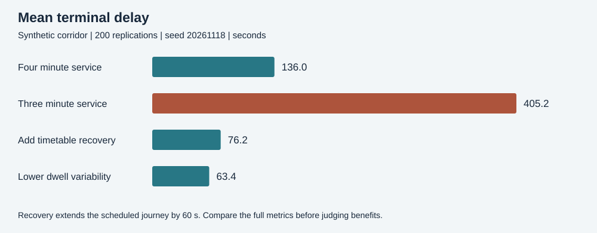

# Rail Operations Lab

Two reproducible learning case studies in **timetable data quality** and
**corridor delay simulation**, using Python and SQL. Built by Eric Tran with AI
assistance to explore rail operations and explain analytical trade-offs.

This is an independent educational prototype. All timetable and operating data
are invented; no Metro, DTP or V/Line data, affiliation or endorsement is implied.
The project is evidence of a learning exercise, not professional rail-modelling
experience or proficiency with a specialist rail simulation package.

## Run in under a minute

Python 3.11 or later, with SQLite window-function support. No third-party Python
packages, API keys, database server or network access are required.

```bash
git clone --branch rail-operations-lab --single-branch https://github.com/hundredplus/epivintage-research-explorer.git rail-operations-lab
cd rail-operations-lab
python -m unittest discover -s tests -v
python -m railops
```

Open `reports/report.html` in a browser. Review the committed
[scenario metrics](reports/scenarios.csv), [SQL spacing checks](reports/headways.csv),
[full results and example traces](reports/results.json), and
[model assumptions](docs/method.md). To reproduce elsewhere:

```bash
python -m railops --replications 200 --seed 20261118 --output /tmp/railops-results
```

The project is published on the dedicated `rail-operations-lab` branch of an
existing portfolio repository. The default branch contains the separate
EpiVintage project; this branch contains only Rail Operations Lab.

## Case study 1 — Can we trust the timetable extract?

[`timetable.py`](railops/timetable.py) reads a small, single-service-day extract:
four trips, four stops, sixteen stop-time records. It checks mandatory fields,
duplicate identifiers, stop/trip references, time formats, stop sequence and
chronological consistency. SHA-256 hashes identify the exact inputs used.

The [SQL query](sql/headways.sql) uses `LAG` partitioned by route, direction and
stop to calculate successive scheduled departure spacings. Terminal arrivals
are excluded. Manually checked example: **240, 180 and 300 seconds** at stop A.
An illustrative 240-second screen flags three departures across three stops.
These are review flags; track conflicts cannot be established from these fields.

The schema is **GTFS-inspired, not a complete GTFS feed or validator**. It does
not expand calendars, load a Victoria feed, or join different routes sharing
infrastructure. The CSV filenames and mandatory subset are specific to this lab.
Service-day times beyond midnight, such as `25:10:00`, are supported.

## Case study 2 — How do frequency and variability change delay?

[`simulation.py`](railops/simulation.py) models sixteen trains on three one-way
segments. Each segment is an exclusive resource with a running time and
clearance interval. Trains retain timetable order, wait for the resource, and
never depart early. Stochastic origin and intermediate dwell delays are sampled
for 200 replications, with shared uniform draws for paired scenario comparisons.

Committed example results, seed 20261118 (seconds):

| Scenario | Mean terminal delay | P95 terminal delay | Scheduled journey |
| --- | ---: | ---: | ---: |
| Four-minute service | 136.0 | 190 | 630 |
| Three-minute service | 405.2 | 640 | 630 |
| Add 30 seconds recovery per intermediate stop | 76.2 | 130 | 690 |
| Reduce maximum extra dwell from 90 to 30 seconds | 63.4 | 95 | 630 |

**Interpretation:** scheduling every 180 seconds against a 210-second assumed
resource occupancy creates queues. Adding recovery improves lateness against a
longer timetable, so punctuality alone is an incomplete measure. Lower dwell
variability explores another mechanism without extending the scheduled journey.
These are model outputs under assumptions, not measured operational benefits.



The data-quality extract and the simulation are **separate examples**. The CLI
runs both; it does not infer simulation parameters from timetable CSVs.

## Verification and limitations

18 automated tests cover hand-calculated cases, clearance and continuity
invariants, repeatability, after-midnight times and invalid inputs. A GitHub
Actions workflow runs the suite on Python 3.11–3.13 when pushed. Local test
results are not a claim that remote CI has already passed.

This is a finite cohort entering an empty corridor, not steady-state capacity
analysis. It omits junctions, opposing movements, signalling, braking, finite
station/storage capacity, crews, rolling stock and passengers. Calibration,
independent validation and operator review would be required before practical
use. The 60-second threshold is chosen for this exercise, not a Metro KPI.

## Review the work

1. Run the deterministic two-train test and calculate its 30-second queue by hand.
2. Change the service interval from 240 to 180 seconds; explain why queues grow.
3. Compare scheduled journey time as well as delay when adding recovery.
4. Explain why the SQL spacing flags do not prove track conflicts.
5. State which observed data would be needed to calibrate the model.

See the [walkthrough](docs/walkthrough.md) for exercises and
[method](docs/method.md) for equations, assumptions and next steps.

## Technical references

- [GTFS Schedule Reference](https://gtfs.org/documentation/schedule/reference/)
  for service-day time conventions and stop-time concepts.
- [SQLite window functions](https://www.sqlite.org/windowfunctions.html)
  for ordered SQL comparisons.
- [Python random module](https://docs.python.org/3/library/random.html)
  for seeded pseudorandom sampling.

MIT licence. AI-assisted source and documentation should be reviewed and
understood by the presenter before claiming independent implementation ability.
